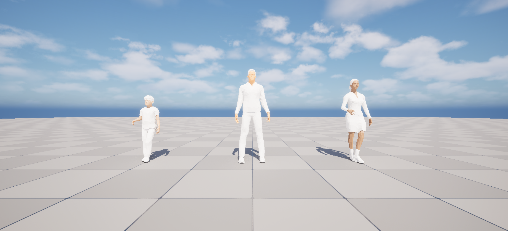

# GEMSTAR UE_VRU_Feature

[](https://www.dlr.de/en/ts/about-us/the-institute-of-transportation-systems)

This plugin adds VRU (vulnerable road users) models

# Getting started

First clone the [gemstar_interfaces](https://github.com/DLR-TS/gemstar_interfaces) plugin inside the Plugins directory and the `ue_vru_feature` inside Plugins/GameFeatures.

Add the plugin to your Unreal project:
```sh
mkdir Plugins/GameFeatures
cd Plugins/GameFeatures

git clone https://github.com/DLR-TS/ue_vru_feature.git
```
or:
```sh
git submodule add https://github.com/DLR-TS/ue_vru_feature.git
```

# Configuration

```ini
[ue_vru_feature]
;select the input for VRUs
Input=[ue_sumo_feature, ue_esmini_feature]
```
Choose the input for the VRUs with the Input entry.
Supported data sources are currently [ue_sumo_feature](https://github.com/DLR-TS/ue_sumo_feature) and [ue_esmini_feature](https://github.com/DLR-TS/ue_esmini_feature).

# Test Map

A simple test map is provided in the Content/Test directory.
It tests the position update of the VRUs.
This plugin contains basic models for a child, a men and a woman.



---------------
**Contact:** opensource-ts@dlr.de

This project uses the Open Simulation Interface ([OSI](https://github.com/OpenSimulationInterface/open-simulation-interface)), which is licensed under the
Mozilla Public License 2.0.